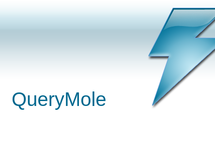

<p align="center">
  
</p>

<p align="center">
  <b>The classic MySQL Query Browser, revived for current MySQL and MariaDB.</b><br>
  Windows · Linux · (macOS later)
</p>

<p align="center">
  
  
  
  
</p>

---

**QueryMole** brings back the **MySQL Query Browser** (2006): the original Windows user interface, rebuilt with
Free Pascal and Lazarus so that it runs on Windows and Linux, against MySQL 5.7 to 9 and MariaDB 10.11 and 11.4.
The look and behaviour stay those of the original until it is complete (ADR-0001); new features come after that.

> [!WARNING]
> **Alpha.** The program connects, runs queries, shows and edits results, runs scripts and exports, but it has
> known faults (see [Known problems](#known-problems)). Use a test account or a test server and keep your own
> backups.

> [!NOTE]
> QueryMole is not affiliated with or endorsed by Oracle. "MySQL" is a trademark of Oracle and names only the
> product this project is based on (ADR-0030).

## Contents

- [Features](#features)
- [Download and run](#download-and-run)
- [Known problems](#known-problems)
- [Reporting problems](#reporting-problems)
- [Building from source](#building-from-source)
- [How it is made](#how-it-is-made)
- [Repository layout](#repository-layout)
- [Licence](#licence)

## Features

Checked against **MySQL 5.7, 8.0, 8.4, 9** and **MariaDB 10.11, 11.4**: an automated test suite and the
application's self-tests run against all six servers in throw-away containers.

| Area | What works |
|---|---|
| **Connecting** | connect dialog with stored connections; TLS "preferred" with fallback to an unencrypted connection |
| **Browsing** | schema tree with search |
| **Querying** | SQL editor with highlighting, several result tabs, EXPLAIN, stopping a running query on the server |
| **Results** | result grid with editing (apply and discard) |
| **Scripts** | scripts with breakpoints |
| **Tables** | table editor that keeps tables intact on current servers; data types and storage engines follow the server (ADR-0034) |
| **Export** | CSV, HTML, XML, Excel and PLIST |
| **Help** | help panel whose SQL reference comes from the connected server |
| **More** | options dialog, text search, regular expression importer |
| **Updates** | the Linux AppImage updates itself (Help > Check for Updates, ADR-0037) |

## Download and run

Releases are published as GitHub pre-releases: **<https://github.com/aurora/querymole/releases>**

<table>
<tr><th>Platform</th><th>How</th></tr>
<tr><td><b>Windows</b><br>64 bit</td><td>

Unpack the zip and run `querymole.exe`. Settings and connections are kept in `%APPDATA%\QueryMole\`. On the first
start, the settings of the original MySQL Query Browser are copied from `%APPDATA%\MySQL\` (that folder is left
as it is). The zip does not update itself; download the new version and replace the old one.

</td></tr>
<tr><td><b>Linux</b><br>x86_64</td><td>

```bash
chmod +x QueryMole-*.AppImage
./QueryMole-*.AppImage
```

The AppImage brings GTK2 and the other libraries it needs and runs on distributions with **glibc 2.34 or newer**
(RHEL 9, Ubuntu 22.04, Debian 12, Fedora 35 and newer). It needs libstdc++ and an X server (XWayland on a Wayland
desktop). Without FUSE 2 on the system, start it with `--appimage-extract-and-run`.

Settings are kept in `~/.config/querymole/` (`$XDG_CONFIG_HOME`); on the first start, those of the original Linux
version are copied from `~/.mysqlgui/`. The AppImage updates itself in place (ADR-0037).

</td></tr>
<tr><td><b>macOS</b></td><td>Not yet; the first build is being prepared (<a href="docs/macos-setup.md">docs/macos-setup.md</a>).</td></tr>
</table>

## Known problems

- **Linux (GTK2):** a crash after connecting was seen once (heap corruption), and the window froze once while
  scrolling the schema tree of a database with many tables. Neither has been reproduced; if it happens to you,
  see [Reporting problems](#reporting-problems).
- **Not worked through on a desktop yet:** real mouse and keyboard use, drag and drop, bookmarks and history, the
  field viewer; the checklist is in [docs/linux-manual-test.md](docs/linux-manual-test.md).
- **Table editor:** generated columns, `ON UPDATE`, `INVISIBLE` and CHECK constraints are kept when a table is
  edited, but not shown or editable yet (ADR-0035).
- **Linux on a scaled (HiDPI) desktop:** the layouts are in pixels for 96 dpi and GTK's dpi is pinned to 96; use
  the desktop's scaling for X11 applications (KDE: "Legacy applications: scaled by the system"). Real HiDPI
  support comes later (ADR-0009).
- **Linux:** no "OS specific" password storage, only "Plaintext" and "Obscured" (ADR-0021); no global hot keys
  (ADR-0022). This release uses GTK2; a Qt version is planned (ADR-0024).
- **Windows:** no installer and no updates yet (Velopack's `Setup.exe` is planned, ADR-0037).
- The user interface is the original's, including its look and its English texts; some parts look different
  under GTK2 than on Windows.

Details and the state of the Linux port: [docs/linux-port.md](docs/linux-port.md).

## Reporting problems

Please open an issue at **<https://github.com/aurora/querymole/issues>** with:

- the version (Help > About), the operating system and, on Linux, the desktop;
- the server and its version;
- what you did in the last seconds before the problem;
- if the program ended: the file `querymole.error.txt` next to the program, if there is one, and, if you can, a run with
  `QBR_TRACE=1` (this writes `qbr.trace.txt` next to the program).

## Building from source

The full instructions are in [AGENTS.md](AGENTS.md) ("Toolchain" and "Everyday commands"). In short:

- **Windows:** Lazarus 4.8 / FPC 3.2.2, MSYS2 with the mingw64 toolchain, Python 3.
- **Linux:** the Fedora distrobox created by `tools/distrobox-setup.sh` (Lazarus, FPC, the backend libraries,
  Python), entered with `distrobox enter freepascal`.

```bash
git submodule update --init      # once, for third_party/velopack-pas
./build.sh --backend --runtime   # C backend, application, data files next to the program
./build.sh --run                 # build and start
tests/run-matrix.sh              # test suite against all six servers (Linux; needs podman)
```

Packages: `tools/package.sh` (Windows zip) and `tools/package-appimage.sh [--velopack]` (Linux AppImage).

## How it is made

QueryMole is a port of the original sources, which are kept unchanged in `legacy/`: the C libraries are built
again with CMake, the Delphi user interface is converted to Lazarus forms and ported unit by unit. It is done by
Harald Lapp **with the help of Claude Code** (Anthropic), an AI coding assistant, which wrote and changed a large
part of the code and documentation under the owner's direction.

- Decisions: [docs/adr/](docs/adr/README.md) (Architecture Decision Records; they are binding)
- Plan and backlog: [ROADMAP.md](ROADMAP.md)
- The original authors are credited in the About dialog.

A thin database-driver interface is planned so that other databases (e.g. PostgreSQL) can follow later
(ADR-0010).

## Repository layout

| Directory | Purpose |
|---|---|
| `legacy/` | original sources (GPL), kept unchanged as reference |
| `backend/` | CMake build of the C libraries of the original Query Browser |
| `bindings/` | Pascal bindings for the backend (mostly generated) |
| `app/` | the Lazarus / Free Pascal application (ported from the Delphi UI) |
| `tests/` | FPCUnit tests that run against real servers |
| `tools/` | generators, form converter, packaging and analysis scripts |
| `assets/` | QueryMole artwork |
| `third_party/` | the Velopack binding (git submodule) |
| `docs/` | decisions, porting notes, screenshots of the converted forms |

## Licence

GPL-2.0-or-later, like the original MySQL Query Browser; see [LICENSE](LICENSE) and [NOTICE](NOTICE) (inherited
PCRE exception, third-party components). "MySQL" is a trademark of Oracle; this project is not affiliated with it.
