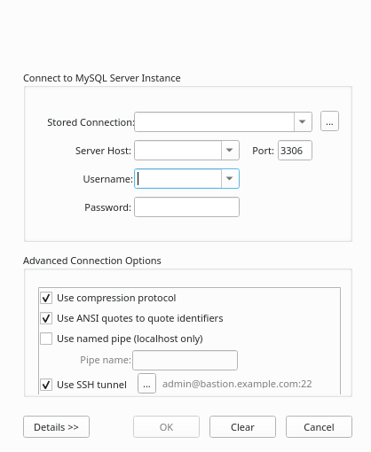
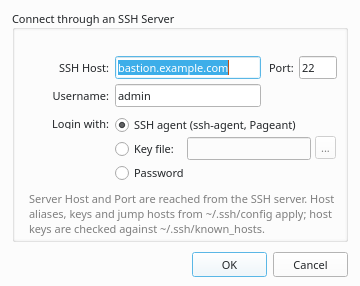
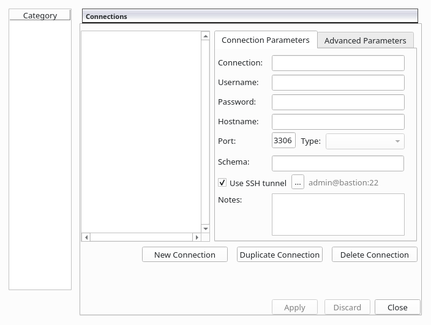

<!-- SPDX-License-Identifier: GPL-2.0-or-later -->
# ADR-0048 — SSH tunnel for connections, built on libssh

- Status: Proposed (library chosen, mock-up below; the checks listed under "Open" before implementation)
- Date: 2026-11-20
- Deciders: Harald Lapp (project owner)

## Context

Database servers are often reachable only through SSH: the server listens on localhost or on an internal network,
and users connect through a bastion host. The original Query Browser had no SSH support; users opened a tunnel by
hand (`ssh -L`, PuTTY) and connected to the local port. Users ask for the tunnel inside the program, with OpenSSH
keys and with PuTTY keys (`.ppk`, often held in Pageant on Windows). It is the first feature under ADR-0047
(additive, off by default, own decision).

Two ways were considered: start the system's `ssh` client, or run SSH inside the program with a library. For the
library, libssh (LGPL-2.1-or-later) and libssh2 (BSD-3-Clause) were compared on 2026-11-20
(`docs/ssh-tunnel-libraries.md`). The relevant findings:

- Neither library reads `.ppk` files.
- libssh checks and updates the user's OpenSSH `known_hosts`, reads `~/.ssh/config` and handles `IdentityAgent`;
  its own ProxyJump implementation exists from 0.11 (0.10 starts the `ssh` program for it). It talks to the agent by
  `SSH_AUTH_SOCK` and to the Windows OpenSSH agent pipe, not to Pageant's window messages.
- libssh2 has Pageant built in, but no config file support, no jump hosts and only a low-level known-hosts API.
- Pageant 0.75 and later also listens on a Windows named pipe that the Windows OpenSSH client uses directly
  (PuTTY manual, section 9.3.3), so a client of the OpenSSH agent pipe can reach Pageant if it knows the pipe name.
- Packages: libssh 0.12 on Fedora and MSYS2; AlmaLinux 9, where the AppImage is built, has 0.10.4.

## Decision

- **The tunnel runs inside the program, on libssh.** A tunnel thread opens the SSH session, listens on a free port
  of 127.0.0.1 and forwards each accepted connection through a `direct-tcpip` channel to the database host and port
  as seen from the SSH server. Connector/C connects to 127.0.0.1 and that port; nothing else in the connection code
  changes. The tunnel lives as long as the connection (and its reconnects) and is closed with it.
- **Authentication**, tried in this order like OpenSSH: the agent (`SSH_AUTH_SOCK` on Linux; on Windows the OpenSSH
  agent pipe, and Pageant's pipe when Pageant runs), a key file, then a password. Key files:
  - OpenSSH and PEM files through libssh;
  - **PuTTY `.ppk` (formats 2 and 3)** through our own reader, which decrypts the key in memory (format 3 uses
    Argon2, taken from OpenSSL 3.2+ where available) and passes it to libssh in OpenSSH form. No converted copy is
    written to disk.
  Passphrases and SSH passwords are asked for when needed; whether they may be stored follows the existing password
  storage setting of the stored connections.
- **Host keys** are checked against the user's OpenSSH `known_hosts`. An unknown host shows its SHA-256 fingerprint
  and asks before it is trusted (and then written to `known_hosts`); a changed key refuses the connection with a
  message, as `ssh` does.
- **`~/.ssh/config` is read**, so a host alias, user, port, identity file, `IdentityAgent` and `ProxyJump` given
  there apply. The dialog has no field for jump hosts; they come from the config file.
- **UI, additive and off by default** (ADR-0047), the same in both places that edit a connection:
  - one row "Use SSH tunnel" with a "..." button and a grey summary (`user@host:port`) of the tunnel;
  - in the connect dialog's "Details >>" area it takes the place of the original's hidden SSL check box, below
    "Pipe name"; the dialog keeps its size;
  - in Options > Connections, "Connection Parameters", it sits between "Schema" and "Notes", whose field gives up
    one line; a third tab was tried and dropped, three tabs do not fit side by side (less so with the German texts);
  - "..." opens one small dialog "SSH Tunnel": SSH host and port, user name, login with the agent (ssh-agent,
    Pageant), a key file (OpenSSH or `.ppk`, with a browse button) or a password, and a short note that Server Host
    and Port are reached from the SSH server and that `~/.ssh/config` and `known_hosts` apply;
  - a connection without SSH shows the dialogs as before apart from that unchecked row.
- **Storage:** the settings are stored as entries of the stored connection's existing advanced option list
  (`SSH_TUNNEL=Yes`, `SSH_HOST=...`, `SSH_PORT=...`, `SSH_USER=...`, `SSH_AUTH=agent|key|password`,
  `SSH_KEYFILE=...`; for special cases and the tests also `SSH_CONFIG=...` and `SSH_KNOWN_HOSTS=...` instead of the
  user's files); the connect code applies only the advanced options it knows, so earlier releases keep these entries
  and ignore them.
- **One place connects:** `SSHConnectToInstance` (`app/src/SSHConnect.pas`) replaces `myx_connect_to_instance` at
  every place the program connects (connect dialog, connect, reconnect, the threads of result tabs, query cancel).
  Tunnels are pooled and shared by all connections with the same SSH settings and target; a broken tunnel is opened
  again on the next connect, with the password or passphrase typed before kept in memory for that. Questions to the
  user always run in the main thread.
- **Packages:** Windows bundles MSYS2's libssh (0.12); the AppImage builds libssh 0.11 or later itself, as it does
  for libQt6Pas, because AlmaLinux 9's 0.10.4 has no own ProxyJump. libssh goes into `docs/licenses.md` and
  `NOTICE`.
- **Tests:** an OpenSSH server container joins `tests/run-matrix.sh`; the suite connects through it with key,
  passphrase-protected key, `.ppk` (format 2 and 3), password, an unknown and a changed host key, and a jump host.

## Mock-up

Rendered from the converted forms by `docs/mockups/ssh-tunnel/make_mockups.py` (Qt6, Fusion style, the bundled
fonts; the connect dialog without its banner and title bar, which `lfmview` does not draw). The values are examples.

| Connect dialog, "Details >>" | "SSH Tunnel" dialog | Options > Connections |
|---|---|---|
|  |  |  |

## Consequences

Positive:
- Servers behind SSH are reachable without a separate tool or terminal; the tunnel's lifetime follows the
  connection, including reconnects.
- Host key checking, config file and jump hosts behave as with `ssh`, using the user's existing files.
- PuTTY users can use their `.ppk` files and Pageant without converting keys.
- Earlier releases keep stored connections with SSH settings intact.

Negative:
- A new library in both packages (libssh with its crypto backend), and on Linux one more library built from
  source for the AppImage.
- Our own code for the forwarding loop, the `.ppk` reader (including Argon2 where OpenSSL is too old), Pageant's pipe
  name and the host-key prompt: security-sensitive code to maintain and test.
- An earlier release opening a stored connection with SSH settings connects directly to the database host field
  (typically `127.0.0.1` as seen from the SSH server) and may reach a different, local server.
- The connect dialog and the connection options gain controls that the original did not have.
- Agent forwarding, SOCKS proxies, remote forwarding and X11 are not covered.

## Alternatives considered

- **Start the system's `ssh` (or `plink`) with `-L`.** Rejected: depends on an installed client (not on every
  Windows), prompts and errors come from another process and cannot be shown in the dialog, `.ppk` files would have
  to be written to disk in OpenSSH form or need `plink` on Windows only, and the process has to be supervised and
  cleaned up.
- **libssh2.** Rejected for now: Pageant built in, but host-key policy, config files and jump hosts would be our
  code; not in AlmaLinux 9's base repositories. Remains the fallback if libssh's agent support on Windows proves
  insufficient.
- **No tunnel; document `ssh -L`.** Rejected: that is the situation users ask to leave.

## Open (to settle before or during implementation)

- Pageant: its pipe name is now known from the PuTTY source (`\\.\pipe\pageant.<user>.<SHA-256 of the
  CryptProtectMemory-encrypted string "Pageant">`, details in `docs/ssh-tunnel-libraries.md`) and the pipe speaks the
  OpenSSH agent protocol; the program computes the name, uses the pipe when it exists, and an `IdentityAgent` in
  `~/.ssh/config` wins. Pageant before 0.75 is not supported. Still to test on Windows with a running Pageant.
- Whether MSYS2's libssh builds with agent support on Windows as expected, and which crypto backend both packages
  use.
- The wording of the new texts and their translation entries (German first, as the original ships it).
- Where the new form's `.lfm` lives: `app/forms` holds forms generated from the original's `.dfm` files; a form
  written for the revival needs a place the generator leaves alone.

## Related

- ADR-0047 — the rules for features after parity that this follows.
- ADR-0005, ADR-0042 — TLS to the server; unchanged by the tunnel (TLS runs inside it).
- ADR-0043 — dead connections; the tunnel needs the same treatment (timeouts, keep-alive on the SSH session).
- ADR-0027, ADR-0037 — the AppImage build that has to bundle libssh.
- `docs/ssh-tunnel-libraries.md` — the library comparison with sources.
