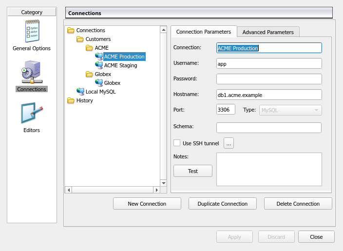

<!-- SPDX-License-Identifier: GPL-2.0-or-later -->
# ADR-0051 — Connection manager: a test button and groups of connections

- Status: Proposed (built; screenshot below)
- Date: 2026-11-21
- Deciders: Harald Lapp (project owner)

## Context

The stored connections are edited in Options > Connections: a tree with the folders "Connections" (stored) and
"History" on the left, the tabs "Connection Parameters" and "Advanced Parameters" on the right. Two things users
miss there:

- **Testing a connection** without closing the dialog and connecting from the main window. With the SSH tunnel
  (ADR-0048) there are more settings that can be wrong (host key, key file, user), so a quick check matters more.
- **Groups.** With many connections (customers, stages) one flat list is hard to use.

What is there already: the tree supports nodes inside the folders and drag and drop between them (the port made
group nodes drop targets). Every stored connection has a field `storage_path` in the file format; the original reads
and writes it (`myx_xml_user_connections.c`) but its UI never uses it, and it is empty in practice.

Features follow ADR-0047: additive, off by default, in the original's style, files readable by the previous release.

## Decision

**Test button**

- A button "Test" on "Connection Parameters", in the left column below the "Notes:" label, where the form has free
  space; the layout of the other controls does not change.
- It tests the values in the form as they are, applied or not: user, password, host, port, schema, the advanced
  parameters and the SSH tunnel row. An empty password is asked for (masked, not stored).
- The test connects in a background thread through the same path as the program (`SSHConnectToInstance`, so the
  tunnel and its host key question are part of it) and the dialog stays responsive. The result is a message: the
  server and its version (and the SSH server when tunnelled), or the error of the server or of the tunnel. The test
  connection is closed again at once.

**Groups**

- A stored connection's group is its `storage_path`: a path of group names separated by `/` (`Customers/ACME`),
  empty for no group. History entries have no groups.
- The tree shows groups as folders inside "Connections" (the same folder icon), nested by the path; connections
  without a group stay directly in "Connections", so a user who never makes a group sees the tree as before.
- A context menu on the tree: "New Group..." (inside the selected group or "Connections"), "Rename Group...",
  "Delete Group" (its connections move to the group above it; nothing is deleted).
- Drag and drop: a connection dropped on a group goes into it; dropped on a connection, it takes that connection's
  group (as before, it is placed before it).
- Stored in the existing field, so files stay readable by earlier releases, which keep the field and show the
  connections ungrouped.
- A group exists as long as it holds a connection: an empty group is not stored and is gone the next time the
  dialog opens (the format has no place for empty groups; the menu says nothing else).
- The connect dialog's "Stored Connection" list stays as it is (names only). Showing groups there would put the
  group into the text that the dialog also uses as the connection's name; left for later.

## Screenshot

The built version (Qt6, `--shot-options` with connections in groups `Customers/ACME` and `Customers/Globex` and one
without a group): the groups as folders inside "Connections", the "Test" button below "Notes:".

Checked on the matrix: `--selftest-test-connection` runs the test of the button for a stored connection through the
SSH tunnel ("ok: Connected to ..., server version ... The connection went through the SSH server ...") and with a
wrong password ("failed: ... MySQL error 1045 ..."); `tests/test_connection_groups.pas` checks that `storage_path`
survives loading and saving.

## Consequences

Positive:
- A connection, including its SSH tunnel, can be checked where it is edited.
- Many connections can be organised without a new file format; earlier releases keep the groups intact.

Negative:
- Two controls more in a dialog of the original (a button, a context menu).
- Empty groups vanish; a user may be surprised once.
- The connect dialog does not show the groups yet, so connections with the same name in different groups look the
  same there.
- The test uses the form's values, which may differ from the stored ones until Apply; the message says which host
  was tested.

## Alternatives considered

- **The test button in the button row below the tree** (New / Duplicate / Delete Connection): the row is full; a
  fourth button would need narrower buttons, too narrow for the German texts.
- **Groups as a new element in the file format** (to keep empty groups): earlier releases would drop it when they
  save; `storage_path` is kept by them.
- **Groups in the connect dialog's list now**: needs a change to how the dialog takes the connection name from the
  list; separate step.

## Related

- ADR-0047 — the rules for features after parity.
- ADR-0048 — the SSH tunnel, which the test uses.
